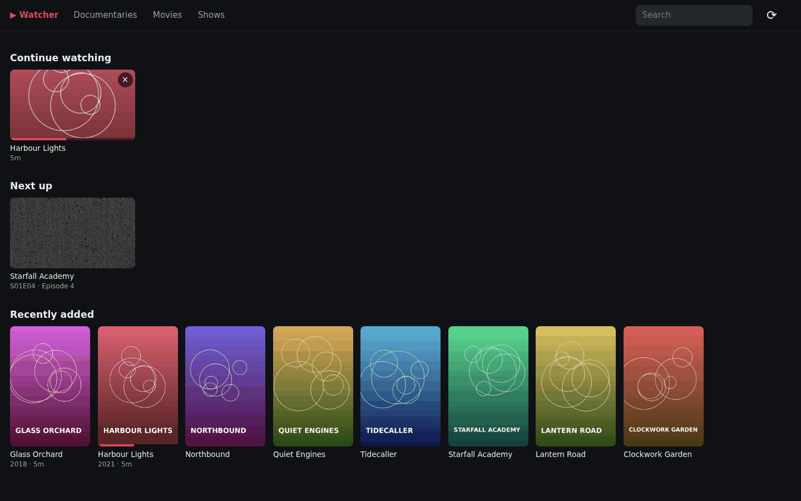
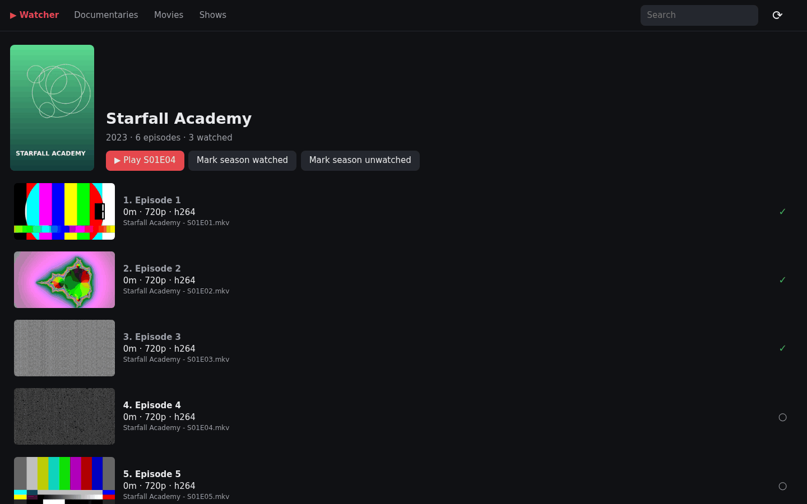
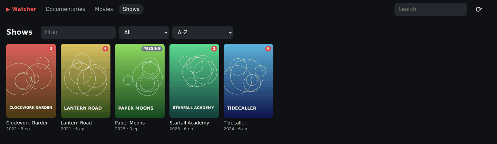

# Media Watcher

A small, fast, single-user media server for a NAS. It does one thing: browse
your library and play it in the browser, reliably. No actors, no user
management, no subtitles; posters and descriptions come from TMDB and
AniList.

| | |
|---|---|
|  |  |
|  |  |

<sub>Screenshots use generated test videos and placeholder posters.</sub>

- **Plays everything.** Each file is played the cheapest way that works:
  direct (byte ranges, zero CPU), remux (video copied, audio converted if
  needed, near-zero CPU), or transcode only when the browser cannot decode
  the video codec at all. If playback fails anyway, the player steps down
  by itself (direct → remux → full transcode) instead of buffering forever.
  When a file needs a CPU transcode, the player shows **⚠ Convert** with
  the ffmpeg commands to re-encode it (and the rest of its folder) to
  8-bit H.264 once, so after that it only ever needs a remux.
- **Converts what can't be watched.** The first time a file needs a CPU
  transcode, the server also queues a one-off conversion to a
  browser-playable MP4 and plays that copy directly once it is ready. See
  [Automatic conversion](#automatic-conversion).
- **Japanese audio, always.** The audio track is auto-selected: preferred
  language first (`AUDIO_LANGUAGES`, default Japanese), commentary tracks
  last, then the default flag. You can still switch track in the player;
  the language you pick is remembered for the rest of that series.
- **Never shows subtitles.** Subtitle streams are never sent to the browser,
  in any mode.
- **Fast.** One static Go binary (standard library only) + ffmpeg. Library
  pages are one small JSON request; posters/thumbnails are pre-generated and
  downscaled on the SSD so grids never pull full-size images over SMB.
- **Watch progress.** Resume, continue watching, next up, auto-play next
  episode, mark watched/unwatched per episode or season. Library pages can
  hide watched titles or show only those in progress, and long A–Z grids
  get a letter bar.
- **Skip intro / credits** from the file's own chapters: MKVs whose
  chapters are named `Opening`/`OP`/`Intro` or `Ending`/`ED`/`Credits` get
  a skip button while that chapter plays. When the credits run to the end
  of the file the button goes straight to the next episode.
- **Light on the NAS.** A remux or transcode paused for 3 minutes stops its
  ffmpeg process; pressing play restarts it at the same spot.
- **Posters from TMDB and AniList.** Each scan looks up new series and
  movies on [TMDB](https://www.themoviedb.org/) (with a free
  `TMDB_API_KEY`) and then [AniList](https://anilist.co/) (anime, no key)
  and stores a poster and a description. See [Metadata](#metadata).
- **Download button** on every file, plus a direct URL for VLC/mpv for when
  you want to play the original.

## Quick start

```sh
echo "API_KEY=$(openssl rand -hex 24)" > .env   # see .env.example
# edit the volume paths in docker-compose.yml
docker compose up -d --build
```

Open `http://<nas>:8097` and sign in with the API key. The first scan starts
immediately; new files show up on the next scan (every 30 min by default) or
when you press ⟳ in the header.

**On TrueNAS** the compose file above can't be used as-is: a custom app has
no checkout to build from and no `.env`. The Gitea workflow in
`.gitea/workflows/build.yml` pushes an image to the registry instead; see
[docs/truenas.md](docs/truenas.md) for installing it as a custom app.

### Volumes

| Mount     | What                                              | Lose it?                                      |
|-----------|---------------------------------------------------|-----------------------------------------------|
| `/media`  | your library, mount **read-only**                 | –                                             |
| `/cache`  | library index (`library.json`) + thumbnails. Put it on SSD. | fine, rebuilt by the next scan      |
| `/config` | `progress.jsonl` with watch progress (tiny)       | you lose watched/resume state                 |

Item ids are derived from the path inside the library, so wiping `/cache`
or changing the host mount path keeps your watch progress.

### Libraries

By default every folder directly under `/media` is a library
(`/media/Anime`, `/media/Movies`, …). A folder whose name contains "movie"
or "film" is treated as movies only; everything else is auto-detected per
file. Mount your shows *inside* a library folder, not at `/media` itself,
or every show becomes its own library.

A show folder with no video files in it yet (outside movie libraries) still
appears in its library, as a series with no episodes marked **MISSING**, so
you can see what should be there. It fills in once episodes show up.

To be explicit, set `LIBRARIES` (`Name=/path:type`, `;`-separated, type is
`auto`, `shows` or `movies`):

```
LIBRARIES=Anime=/media/anime:shows;TV=/media/tv:shows;Movies=/media/movies:movies
```

## Configuration

| Variable          | Default               | Meaning |
|-------------------|-----------------------|---------|
| `API_KEY`         | (required, ≥ 8 chars) | Login key, use 16+ random characters. Also accepted as `X-Api-Key` header or `?api_key=`; see [Security](#security) |
| `MEDIA_ROOT`      | `/media`              | Where libraries are auto-discovered |
| `LIBRARIES`       |                       | Explicit library list, see above |
| `AUDIO_LANGUAGES` | `jpn,ja,japanese`     | Preferred audio, in order of the language tag; titles are matched too ("Japanese 2.0") |
| `AUDIO_CHANNELS`  | `2`                   | Max channels when audio has to be converted (copied audio keeps its channels) |
| `HWACCEL`         | `none`                | `vaapi` for Intel/AMD GPU transcoding (needs `/dev/dri`, see compose file) |
| `VAAPI_DEVICE`    | `/dev/dri/renderD128` | |
| `MAX_HEIGHT`      | `1080`                | Transcodes are scaled down to this; copied video is untouched |
| `VIDEO_CRF`       | `21`                  | x264 quality for transcodes |
| `X264_PRESET`     | `veryfast`            | Use `superfast`/`ultrafast` on a weak CPU |
| `TRANSCODE_THREADS` | `4`                 | libx264 threads per transcode; `0` lets x264 choose (more RAM) |
| `SCAN_INTERVAL`   | `1800`                | Seconds between scans, `0` = only on start and on demand |
| `PROBE_WORKERS`   | `4`                   | Parallel ffprobe processes during scans |
| `THUMB_WORKERS`   | `2`                   | Parallel thumbnail generators |
| `TMDB_API_KEY`    | the image's default   | TMDB key, see below. A v3 API key or a v4 read access token |
| `TMDB_LANGUAGE`   | `en-US`               | Language of descriptions and posters |
| `METADATA_SOURCES` | `tmdb,anilist`       | Sources in the order they are tried; empty or `none` turns lookups off |
| `METADATA_REFRESH_DAYS` | `30`            | Look a title up again after this many days (new posters, late matches) |
| `AUTO_CONVERT`    | `true`                | Convert files that need a CPU transcode in the background, see [Automatic conversion](#automatic-conversion) |
| `CONVERT_CACHE_DAYS` | `14`               | A converted copy not played for this long is deleted |
| `CONVERT_CACHE_GB` | `50`                 | Size limit of the converted copies; least recently played go first |
| `PORT`            | `8097`                | |
| `LOG_LEVEL`       | `INFO`                | |

## Naming

Jellyfin/Kodi naming works as-is, and so do typical release and fansub names:

```
Shows/Example Show (2023)/Season 01/Example Show - S01E05 - Title.mkv
Shows/Example Show (2023)/Specials/Example Show - S00E01.mkv
Shows/Other Show/Season 2/[Group] Other Show - 03 [BD 1080p].mkv
Shows/Show.Name.S02.1080p.BluRay-GRP/Show.Name.S02E03.1080p.BluRay-GRP.mkv
Shows/Some Show/05 - Title.mkv           (bare numbers inside a series folder)
Shows/[Group] Loose Show - 12 (1080p).mkv   (joins "Loose Show" folder if one exists)
Movies/Some Movie (1995)/Some Movie (1995).mkv
```

- Series = the top-level folder inside the library, however deep the
  episodes sit below it (`Show/Show S02/Disc 1/…`, `Show/Arc 2/…` all belong
  to `Show`); the season comes from the nearest `Season NN` / `Specials` /
  `…S02…` folder. Release tags (`1080p`, `x265`, `[Group]`, …) are stripped
  from names.
- Once a show folder has recognised episodes, every other video under it
  joins that show too (unnumbered ones like `Pilot.mkv` included), and
  top-level folders with the same show name (`Show.S01.1080p-GRP`,
  `Show.S02.1080p-GRP`) merge into one series.
- `SxxEyy`, `SxxEyy-Ezz`, `1x02`, `Episode 5`, `Show - 05`/`05v2` are
  recognised. Years are never taken for episode numbers.
- Posters: `poster.jpg`/`folder.jpg`/`cover.jpg` in the series or movie
  folder, then the TMDB/AniList poster from [metadata](#metadata). Episode
  thumbnails: `<file>-thumb.jpg`. Everything else gets a frame grabbed
  from the video.
- Skipped: samples (`*-sample.mkv`, `sample.mkv`), Jellyfin extras
  (`-trailer`, `-featurette`, …), `Extras`/`Trailers`/`NC`/`Menus`/`SPs`
  folders, and NAS clutter (`@eaDir`, `.@__thumb`, `#recycle`, hidden dirs).
- Auto-cleanup: files that disappear are dropped from the library on the
  next scan, along with their thumbnails. If a library folder is missing or
  completely empty (share not mounted, NAS asleep) nothing is deleted.
- Files ffprobe cannot read and library folders that are missing are
  listed on the Problems page (`#/problems`, linked from the home page and
  the scan status), with a button to scan and retry them.

## Metadata

On by default. Every scan gets a *metadata* step after probing that looks
each series and movie up by its cleaned-up title and year, trying the
sources in `METADATA_SOURCES` order until one matches:

1. **TMDB** (series as TV shows), first result wins. Needs a key: get a free
   one at <https://www.themoviedb.org/settings/api> and set `TMDB_API_KEY`
   (either the "API Key" or the longer "API Read Access Token" works).
   Without a key TMDB is skipped.
2. **AniList**, anime only, no key. Its search is fuzzy, so a result only
   counts when one of its titles is the folder title, with or without a
   subtitle (`Frieren` finds "Frieren: Beyond Journey's End", `Heat` does
   not find "Heat Haze Days"); the folder's year breaks ties. Lookups are
   paced to stay under AniList's rate limit (about 2 s per title), so the
   first scan of a large anime library takes a while.

**Default TMDB key.** An image can carry a default key, used whenever
`TMDB_API_KEY` is not set: build with `--build-arg TMDB_API_KEY=<key>`, or
add a repository secret `TMDB_API_KEY` in Gitea and the build workflow
passes it in. The key is readable by anyone who can pull the image, so only
do this for a private registry. A `TMDB_API_KEY` set on the container
always wins.

Only titles that are new, whose folder name changed, or that were last
looked up more than `METADATA_REFRESH_DAYS` ago are sent, so a scan with
nothing new makes no requests. Changing the sources (adding a TMDB key, for
instance) looks everything up once more. If a source can't be reached or
rejects the key, the step stops and everything already fetched stays as it
was; the next scan tries again.

- A `poster.jpg`/`folder.jpg` next to the media still wins over both.
- **Wrong match?** Put the id in the folder (or movie file) name, Jellyfin
  style: `Show (2020) [tmdbid-1399]`, `Heat {tmdb-949}` or
  `Frieren [anilistid-154587]`. The tag skips the search and the other
  source, and is stripped from the displayed title.
- Series pages show the description under the title. Episodes keep their
  own names and frame thumbnails; only series and movies are looked up.
- Everything lives in `/cache` (`library.json` and `metadata/`), so wiping
  the cache only costs one more round of lookups.

This product uses the TMDB API but is not endorsed or certified by TMDB.
Anime metadata from [AniList](https://anilist.co/).

## How playback is decided

The browser reports which codecs it can decode (HEVC, HEVC 10-bit, AV1,
VP9, Opus, FLAC, AC-3, E-AC-3); H.264 8-bit and AAC/MP3 are assumed. Then:

| File                                                        | Mode      | Cost |
|-------------------------------------------------------------|-----------|------|
| MP4/WebM, playable codecs, wanted audio is the first track  | direct    | none, byte ranges |
| MKV/AVI/TS/…, or wanted audio is not the first track         | remux     | video copied; audio copied or → AAC |
| video codec not decodable (HEVC in most desktop browsers, Hi10P H.264, MPEG-2, VC-1, …) | transcode | H.264 encode, HDR tone-mapped to SDR |

The badge in the top-right of the player shows the mode; hover it for the
reason. Seeking in remux/transcode restarts ffmpeg at the new time (copied
video starts on the nearest keyframe, and the player clock is corrected to
match), so jumping around a two-hour movie is instant, not a long buffer.

## Benchmarks

What the server costs while it runs, measured with
[`.claude-task/tools/bench.py`](.claude-task/tools/bench.py): one client plays
a 1080p, 8 Mbit/s, 5-minute file for 60 s, paced at 10 Mbit/s like a browser
filling its buffer, while the CPU time and memory of the server **and every
ffmpeg it starts** are sampled from `/proc` once a second.

| State | CPU (% of one core) | Memory (RSS, server + ffmpeg) |
|---|---|---|
| Idle, library scanned | **0.0 %** | **9 MB** |
| Direct play (H.264/AAC MP4, byte ranges) | **0.1 %** | **9 MB** |
| Remux (H.264 copied, AC-3 → AAC) | **4.6 %** | 67 MB |
| CPU transcode (HEVC → H.264, `veryfast`, 4 threads) | 96 % | 407 MB |

- **Idle is free.** Nothing measurable happens between scans; the Go
  process sits at about 9 MB (14 MB after the browsing test below).
- **Browsing** 1000 `/api/home` requests (10 at a time) took 0.11 CPU-seconds
  in total, about 0.1 ms each: ~6500 requests/s, p99 3.7 ms.
- **Direct play** is the kernel copying the file to the socket; the server
  itself does essentially nothing.
- **Remux** is one ffmpeg copying the video and converting only the audio.
- **Transcode** is the only expensive mode, and it is the one the player
  warns about (**⚠ Convert**) and [converts away](#automatic-conversion) so
  that a file only needs it once.
- Static binary: 6.7 MB.

Setup: an Apple-silicon (arm64) Docker VM with 16 cores, ffmpeg 5.1, a
library of 28 files, test videos generated with ffmpeg's `testsrc2`. Idle,
direct play and remux barely depend on the CPU; a transcode on a typical
NAS CPU (Celeron/Ryzen embedded) takes several cores and may not keep up in
real time at 1080p, which is why `HWACCEL=vaapi` and automatic conversion
exist. To repeat it against your own server:

```sh
python3 .claude-task/tools/bench.py http://localhost:8097 "$API_KEY" "$(pgrep -x mediawatcher)" \
    <direct item id> <remux item id> <transcode item id>
```

## Automatic conversion

When the browser can only play a file through a CPU transcode (the
**Transcode** badge), opening it also queues a conversion of that file to
an MP4 with 8-bit H.264 video at the source resolution (`MAX_HEIGHT` and
`VIDEO_CRF` only apply to live transcodes; the copy uses CRF 18 with
`X264_PRESET`, HDR is tone-mapped) and a single audio track: the preferred
language (`AUDIO_LANGUAGES`), else English, else the track the player
would pick anyway. Playback starts right away with the live transcode; once
the copy is ready the player uses it as a direct-play file (seeking with
byte ranges, no CPU at all).

- **One job per file, one at a time.** Opening the file again, from any
  browser or tab, shows the job that is already queued or running. ffmpeg
  runs at a lower priority (`nice`) than live streams.
- **Progress.** The player's top bar shows *Converting 34% · 12 min*; the
  ⚠ panel has the details, a cancel button and, when done, *Play converted
  copy* and *Download .mp4*. All jobs and copies are on the Conversions
  page (`#/conversions`, linked from the header while a job runs and from
  the home page).
- **Cache.** Copies live in `/cache/converted`. Each is kept for
  `CONVERT_CACHE_DAYS` (14) after it was last played, and when the folder
  passes `CONVERT_CACHE_GB` (50) the least recently played go first. A copy
  is dropped when its original changes. Queued jobs survive a restart; a
  job that was running starts over.
- **Keeping it.** Download the copy and put it in place of the original if
  you want the better format for good. The copy has no subtitles, and a
  different file name (`.mkv` → `.mp4`) gives the item a new id, so its
  watch progress starts over. For an in-place MKV conversion that keeps
  subtitles, use the ffmpeg commands in the same panel instead.
- A failed conversion is not retried until you press *Retry*. Choosing an
  audio track other than the copy's one plays the original again.
  `AUTO_CONVERT=false` turns automatic jobs off; *Convert now* in the
  player still starts one.

## Player keys

`Space`/`K` play/pause · `←`/`→` 10 s · `J`/`L` 30 s · `↑`/`↓` volume ·
`F` fullscreen · `M` mute · `N` next episode · `<`/`>` slower/faster ·
`S` skip intro/credits · `Esc` back

## External players

`http://<nas>:8097/file/<item id>?api_key=<key>` is the original file with
range support, which VLC, mpv and Infuse can open directly. The item id is
in the player URL (`#/play/<id>`).

## Known limitations

- **Safari / Orion / iOS (WebKit)**: WebKit refuses a progressive MP4
  without byte ranges, which is what remuxed and transcoded streams are. On
  WebKit the player therefore fetches those streams itself and feeds them to
  Media Source Extensions (`ManagedMediaSource` on iOS 17.1+), which also
  turns off AirPlay for them. Direct-play files use the normal player. Older
  iOS without Media Source still only plays direct-play files; that would
  need HLS. To go back to the plain player on WebKit, run
  `localStorage.mse = "0"` in the browser console.
- No subtitle support at all, by design.
- VAAPI arguments are written for the Intel iHD and Mesa drivers but have
  not been tested on real hardware; if transcoding fails with
  `HWACCEL=vaapi`, switch back to `none` and check the container log.

## Security

Media Watcher is meant for a home network or behind a reverse proxy with
HTTPS. There is one secret, `API_KEY`; use a random one
(`openssl rand -hex 24`). The server logs a warning when it is shorter than
16 characters.

- **Sign-in** sets an `HttpOnly`, `SameSite=Strict` session cookie (plus
  `Secure` when the request came over HTTPS, directly or with
  `X-Forwarded-Proto: https`). The cookie is an HMAC of the key, never the
  key itself. It stays valid until `API_KEY` changes; *sign out* only
  removes it from that browser, so change the key to sign out everywhere.
- **Guessing is throttled.** After 10 wrong keys within 15 minutes from one
  IP address (login form, `X-Api-Key` and `?api_key=` alike), every key from
  that address is refused with `429` for 15 minutes, the right one
  included. Browsers already signed in keep working. Behind a reverse proxy
  all clients share the proxy's address (`X-Forwarded-For` is ignored
  because anyone can set it), so a lockout there applies to everyone for
  those 15 minutes.
- **Cross-site requests are refused.** Any request that changes something
  (POST) is rejected with `403` when the browser marks it as coming from
  another site or another app on the same host (`Sec-Fetch-Site`, or an
  `Origin` that is not this server). Scripts that send `X-Api-Key` without
  those headers are not affected.
- Every response has `X-Frame-Options: DENY`, `X-Content-Type-Options:
  nosniff`, `Referrer-Policy: no-referrer` and a CSP that forbids framing
  and plugins. Request URLs, which can contain `?api_key=`, are not written
  to the log.
- `?api_key=` URLs (for VLC/mpv) carry the key in plain text: don't share
  them, and prefer HTTPS when the server is reachable from outside.

## Development

Go 1.23, standard library only; ffmpeg/ffprobe must be on `PATH` (or set
`FFMPEG` / `FFPROBE`). The web UI in `web/` is built into the binary; set
`WEB_DIR=./web` to serve it from disk while editing it.

```sh
go build -o mediawatcher ./cmd/mediawatcher
API_KEY=devkey123 MEDIA_ROOT=./media CACHE_DIR=./cache CONFIG_DIR=./config ./mediawatcher
go test ./...
```

Tests that need ffmpeg/ffprobe skip themselves when those are not installed.
